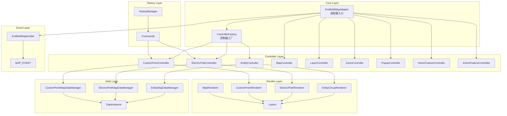
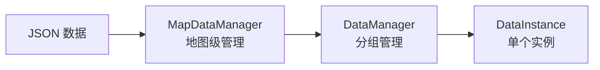
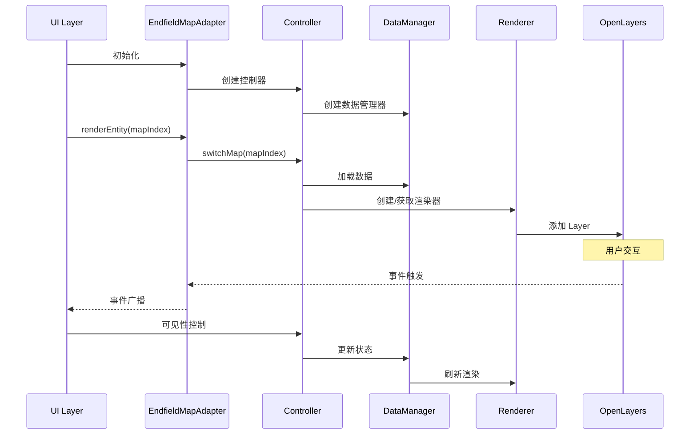
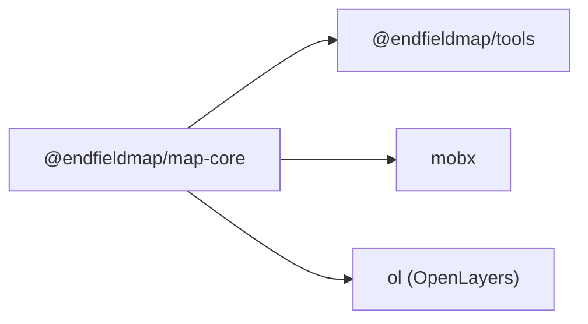

# Map-Core 架构文档

## 概述

`@endfieldmap/map-core` 是 EndfieldMap 项目的核心地图渲染引擎，基于 [OpenLayers](https://openlayers.org/) 构建。它提供了地图渲染、实体管理、事件处理等核心功能，采用 **MVC (Model-View-Controller)** 架构模式设计。

## 技术栈

- **OpenLayers**: 地图渲染引擎
- **MobX**: 响应式状态管理
- **TypeScript**: 类型安全
- **Vite**: 构建工具

## 架构概览



---

## 目录结构

```
src/
├── core/                    # 核心入口
│   ├── adapter.ts           # EndfieldMapAdapter - 主适配器
│   └── controller_factory.ts # 控制器工厂 (DI)
├── controller/              # 控制器层
│   ├── core/                # 核心控制器
│   │   ├── map.ts
│   │   ├── layer.ts
│   │   ├── zoom.ts
│   │   ├── map_layer.ts
│   │   └── area_name.ts
│   ├── entity/              # 实体控制器
│   │   ├── entity_controller.ts
│   │   ├── electric_pole_controller.ts
│   │   ├── custom_point_controller.ts
│   │   └── data_controller.ts
│   ├── feature/             # 特征状态控制器
│   │   ├── active_feature.ts
│   │   ├── hover_feature.ts
│   │   └── hover_connection.ts
│   └── interaction/         # 交互控制器
│       ├── keyboard.ts
│       ├── popup.ts
│       └── event.ts
├── data/                    # 数据层
│   ├── base/                # 基础数据类
│   ├── entity/              # 实体数据管理
│   ├── electric_pole/       # 电线杆数据管理
│   └── custom_point/        # 自定义标点数据管理
├── render/                  # 渲染层
│   ├── layers/              # 图层定义
│   ├── renderer/            # 渲染器
│   ├── factory.ts           # 样式工厂
│   └── map.ts               # 地图渲染
├── event/                   # 事件系统
│   ├── emitter.ts           # 事件发射器
│   └── ...
├── history/                 # 历史记录 (撤销/重做)
│   ├── command.ts           # Command 接口
│   ├── history_manager.ts   # 历史管理器
│   ├── electric_pole_commands.ts
│   └── custom_point_commands.ts
├── types/                   # 类型定义
├── const/                   # 常量定义
└── utils/                   # 工具函数
    ├── id_generator.ts
    └── lru_cache.ts         # LRU 缓存
```

---

## 核心模块详解

### 1. EndfieldMapAdapter (Core Layer)

**文件**: `src/core/adapter.ts`

`EndfieldMapAdapter` 是整个 map-core 的主入口，负责初始化所有控制器和协调各模块之间的交互。

```typescript
interface AdapterConfig {
  container: HTMLElement;       // 地图容器
  asset: EndfieldMapAssetConfig; // 资源配置
  jsonLoader: JSONLoader;        // JSON 加载器
  map?: SimpleMapConfig;         // 地图配置
  popup?: { enabled?: boolean }; // 弹窗配置
}
```

**主要职责**:
- 初始化地图实例
- 创建并管理所有控制器
- 提供 UI 层访问接口
- 地图生命周期管理

**关键方法**:
| 方法 | 说明 |
|------|------|
| `renderMap(mapIndex)` | 渲染指定地图 |
| `renderEntity(mapIndex)` | 渲染实体层 |
| `renderElectricPole(mapIndex)` | 渲染电线杆层 |
| `renderCustomPoint(mapIndex)` | 渲染自定义标点层 |
| `setClusterEnable(enable)` | 设置聚合功能 |
| `addControl(control)` | 添加 OL 控件 |
| `dispose()` | 销毁适配器 |

---

### 2. Controller Layer

控制器层是 MVC 架构中的 **Controller**，负责协调 Data 和 Render 层。

#### 2.1 EntityController

**文件**: `src/controller/entity/entity_controller.ts`

管理地图上所有实体（Entity）的显示和交互。

```typescript
interface EntityControllerConfig {
  jsonLoader: JSONLoader;
  dataPath: string;
  imagePath: string;
  clusterDistance?: number;
  disableCluster?: boolean;
}
```

**主要功能**:
- 实体数据加载和管理
- 可见性控制
- 聚合功能
- 标记过滤（已标记/未标记/全部）

#### 2.2 ElectricPoleController

**文件**: `src/controller/entity/electric_pole_controller.ts`

管理电线杆实体及其连接关系。

**特殊功能**:
- 电线杆创建/删除
- 连接关系管理
- Zone 可见性控制
- 自动连接逻辑

#### 2.3 CustomPointController

**文件**: `src/controller/entity/custom_point_controller.ts`

管理用户自定义标点。

**特殊功能**:
- 自定义标点 CRUD
- 7 种标点类型支持
- 标记数据导入/导出

---

### 3. Data Layer

数据层采用三层结构：**DataInstance** → **DataManager** → **MapDataManager**



#### 3.1 DataInstance

**文件**: `src/data/base/data_instance.ts`

单个数据实体的包装类，提供状态管理。

```typescript
// 核心属性
interface DataInstance {
  id: number;              // 唯一 ID
  data: EntityData;        // 原始数据
  marked: boolean;         // 标记状态
  selected: boolean;       // 选中状态
  active: boolean;         // 激活状态
  visible: boolean;        // 可见状态
  feature: Feature<Point>; // OL Feature
}
```

#### 3.2 DataManager

**文件**: `src/data/base/data_manager.ts`

管理同一类型的 DataInstance 集合。

#### 3.3 MapDataManager

- `EntityMapDataManager`: 管理所有地图的实体数据
- `ElectricPoleMapDataManager`: 管理电线杆数据
- `CustomPointMapDataManager`: 管理自定义标点数据

---

### 4. Render Layer

渲染层负责将数据渲染到地图上。

#### 4.1 Renderers

| 渲染器 | 说明 |
|--------|------|
| `EntityGroupRenderer` | 实体组渲染，支持聚合 |
| `ElectricPoleRenderer` | 电线杆渲染，包含连接线 |
| `ElectricPoleZoneRenderer` | 电线杆覆盖区域渲染 |
| `CustomPointRenderer` | 自定义标点渲染 |

#### 4.2 Layers

| 图层 | 说明 |
|------|------|
| `MapLayer` | 底图图层 |
| `AreaNameLayer` | 区域名称标注 |
| `ActiveLayer` | 当前激活实体高亮 |
| `HoverLayer` | 悬停实体高亮 |

#### 4.3 Style Factory

**文件**: `src/render/factory.ts`

提供 OpenLayers 样式创建工具函数：

```typescript
// 常用工厂函数
createCircleStyle(radius, color, strokeWidth, strokeColor)
createIconStyle(imagePath, size, radius, borderWidth)
createClusterStyle({ radius, size, bgColor, textColor })
createEntityBackgroundStyles(radius, strokeWidth, fillColors, strokeColors)
createHoverRingStyle(radius, baseRadius, strokeWidth, strokeColor)
```

---

### 5. Event Layer

事件系统基于 `EventTarget` 实现，提供类型安全的事件订阅/发布机制。

#### 5.1 EndfieldMapEmitter

**文件**: `src/event/emitter.ts`

```typescript
class EndfieldMapEmitter {
  on<T extends keyof MapEventEmitter>(event: T, listener: MapEventListener<T>): DisposeListener;
  fire<T extends keyof MapEventEmitter>(event: T, detail: MapEventEmitter[T]): void;
  off<T extends keyof MapEventEmitter>(event: T, listener: MapEventListener<T>): void;
}
```

#### 5.2 事件类型

| 事件 | 说明 |
|------|------|
| `zoom:change` | 缩放变化 |
| `map:click` | 地图点击 |
| `map:hover` | 地图悬停 |
| `map:context_menu` | 右键菜单 |
| `entity:click` | 实体点击 |
| `entity:hover` | 实体悬停 |
| `cluster:click` | 聚合点点击 |
| `connection:click` | 连接线点击 |
| `active:feature:change` | 激活实体变化 |
| `hover:feature:change` | 悬停实体变化 |

---

### 6. History Layer

历史记录层提供撤销/重做功能，基于 **Command 模式** 实现。

#### 6.1 HistoryManager

**文件**: `src/history/history_manager.ts`

```typescript
class HistoryManager {
  execute(command: Command): void;  // 执行命令并记录
  undo(): boolean;                  // 撤销
  redo(): boolean;                  // 重做
  canUndo: boolean;                 // 是否可撤销
  canRedo: boolean;                 // 是否可重做
  clear(): void;                    // 清空历史
}
```

#### 6.2 Command 接口

```typescript
interface Command {
  execute(): void;      // 执行
  undo(): void;         // 撤销
  description: string;  // 描述
}
```

#### 6.3 内置 Commands

| Command | 说明 |
|---------|------|
| `CreateElectricPoleCommand` | 创建电线杆 |
| `DeleteElectricPoleCommand` | 删除电线杆 |
| `BatchCreateElectricPolesCommand` | 批量创建电线杆 |
| `BatchDeleteElectricPolesCommand` | 批量删除电线杆 |
| `CreateCustomPointCommand` | 创建自定义标点 |
| `DeleteCustomPointCommand` | 删除自定义标点 |
| `BatchCreateCustomPointsCommand` | 批量创建标点 |
| `BatchDeleteCustomPointsCommand` | 批量删除标点 |

---

## 数据流



---

## 常量定义

**文件**: `src/const/map.ts`

| 常量 | 默认值 | 说明 |
|------|--------|------|
| `DEFAULT_ZOOM` | 3 | 默认缩放级别 |
| `DEFAULT_CENTER` | [0, 0] | 默认中心点 |
| `DEFAULT_MAX_ZOOM` | 5 | 最大缩放 |
| `DEFAULT_MIN_ZOOM` | 1 | 最小缩放 |
| `DEFAULT_CLUSTER_DISTANCE` | 30 | 聚合距离 |
| `DEFAULT_FILL_COLOR` | #525152 | 默认填充色 |
| `DEFAULT_STROKE_COLOR` | #2E2F2E | 默认描边色 |

**图层类型** (`LayerType`):
- `MAP`: 底图
- `AREA_NAME`: 区域名称
- `ENTITY`: 实体
- `ELECTRIC_POLE`: 电线杆
- `CUSTOM_POINT`: 自定义标点
- `ACTIVE_FEATURE`: 激活高亮
- `HOVER_FEATURE`: 悬停高亮

---

## 依赖关系



---

## 工具类

### LRUCache

**文件**: `src/utils/lru_cache.ts`

用于限制缓存大小的 LRU 缓存实现：

```typescript
const cache = new LRUCache<MapIndex, Renderer>(3, (key, value) => {
  value.dispose();  // 驱逐时自动清理
});
```

---

## 扩展指南

### 添加新的实体类型

1. 在 `src/types/entity.ts` 中定义新的数据接口
2. 在 `src/data/` 下创建对应的 DataInstance 和 DataManager
3. 在 `src/render/renderer/` 下创建对应的 Renderer
4. 在 `src/controller/` 下创建对应的 Controller
5. 在 `EndfieldMapAdapter` 中整合新控制器

### 添加新的事件类型

1. 在 `src/const/event.ts` 中添加事件常量
2. 在 `src/types/event.ts` 中定义事件详情接口
3. 在 `MapEventEmitter` 接口中添加事件映射
